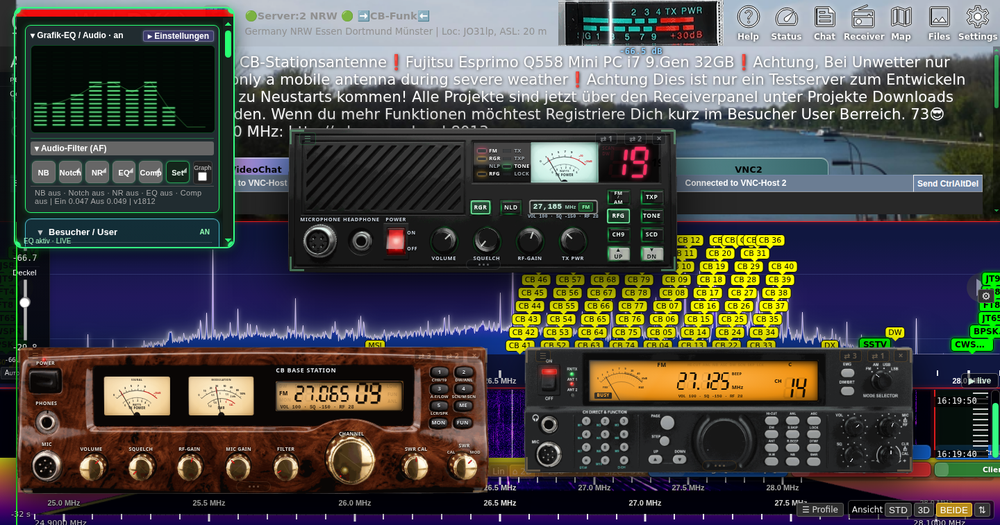

# DNX CB-Funkgeräte Remote (`v1.1.1`)

<!-- DNX-DISCLAIMER-START -->
> **Wichtiger Hinweis / Vollständige Distanzierung (Hobby-Mod-Mode)**
>
> - **Vollständige Distanzierung:** Ich distanziere mich in jeder Hinsicht vollständig vom Projekt **OpenWebRX / OpenWebRX+** sowie dessen Entwicklern und Betreibern. Es besteht keinerlei Verbindung, Zusammenarbeit, Prüfung, Befürwortung oder Partnerschaft.
> - **Keine öffentlichen/offiziellen OpenWebRX-Plugins (nur Mod-Mode):** Bei diesem Projekt handelt es sich ausdrücklich **nicht** um ein öffentliches oder offizielles Plugin von OpenWebRX, sondern ausschließlich um einen privaten, inoffiziellen **Mod-Mode** (Eigenmodifikation).
> - **Warum bewusst kein reines Browser-JavaScript (Mod-Mode-Architektur):** Viele Funktionen (z. B. serverseitige Speicherung, Konten-/Rollenverwaltung, Profil-Synchronisation, VNC-/websockify-Brücken, geschützte Schnittstellen, Docker-/Systemintegration und stabile UI-Anpassungen) lassen sich sauber und sicher nicht allein über simples Client-JavaScript umsetzen, ohne den OpenWebRX-Kern umzubauen oder Browsergrenzen zu umgehen. Deshalb setzt dieses Projekt bewusst auf getrennte Begleitmodule, Shell-Installer und Dienste im **Mod-Mode** statt alles künstlich in reines JavaScript zu pressen.
> - **Kein öffentlicher Support & keine Haftung:** Es gibt **keinen öffentlichen Support**, keine Garantie und keine Haftung. Nutzung, Installation und Anpassung erfolgen vollständig auf eigene Gefahr (immer vorher Backups anlegen und zunächst im eigenen Testsystem prüfen).
> - **Reines Hobbyprojekt – frei nutzbar, änderbar & verbreitbar:** Dieses Projekt entsteht ausschließlich aus reinem Hobby und Interesse am gemeinsamen Funk-/SDR-Hobby. Es steht ausdrücklich frei zur Verfügung und darf frei genutzt, weiterverbreitet, verändert und verbessert werden.
<!-- DNX-DISCLAIMER-END -->

<!-- DNX-PREVIEW-START -->
## Live-Vorschau


<!-- DNX-PREVIEW-END -->

Drei voll bedienbare, markenfreie CB-Funkgeräte als schwebende Fernsteuerung direkt über dem OpenWebRX- / OpenWebRX+-Empfänger — **komplett mit allen hochauflösenden Frontplatten-Grafiken** in einem fertigen Paket.

## Neu in v1.1.1 (`dnx_george2.js v9.13`)

- **Compositor- & S-Meter-Anti-Blink-Fix über WebGL2-/3D-Hintergründen:**
  - Alle drei Geräte-Chassis (`> img`) sowie `.ae8-meter`, `.g2-lcd`, `.ae-display` und `.p3-meter` sind per `isolation: isolate; contain: layout paint style; transform: translateZ(0); backface-visibility: hidden` als eigene GPU-Layer isoliert (`transition: filter` entfernt, `.g2-seg`/`.ae-seg` auf `box-shadow`).
  - Opake Basisfarben auf `.ae8-meter` (`rgb(233, 205, 157)`) und `.p3-meter` (`#def5ef -> #c7e6dd -> #9dc3b8`) verhindern ein Durchscheinen des 3D-Wasserfall-Hintergrunds (`#dnx3d-wrap`/`#dnx3d-canvas`) bei Pegelschwankungen.
  - `P3_LICHT_FILTER.gruen` auf `"none"` gesetzt (`0` teure `BackdropFilter`-Passes im Standardmodus; alle wählbaren Tasten-Farbmodi bleiben aktiv).
  - `0.1°`-Winkel-Cache für S-Meter-Nadeln sowie Dirty-Checks für Text-Updates eliminieren unnötige DOM-Mutationen im Ruhezustand.

## Neu in v1.1.0 (`dnx_george2.js v9.12`)

- **Alle 3 Geräte gehärtet & pixelgenau bedienbar:**
  - Drehregler (Lautstärke, Squelch, RF-Gain, Mic-Gain, Clarifier, Tone, TXP) reagieren auch per exakter Bogen-/Kreisbewegung zuverlässig ohne Fenster-Mitziehen.
  - Kopfbedienelemente (`Menü`, `×`, `⇄ 1/2/3`) sowie alle 4 Skalier-Ecken (`tl / tr / bl / br`) liegen sauber über den Bedienleisten ohne Überlappung.
  - Aufklapp-Menüs richten sich am oberen Bildschirmrand automatisch nach unten aus und schließen sicher per Klick außerhalb.
  - Beim Schließen erscheint der blaue Knopf `#dnx-g2-knopf` mit der zuletzt aktiven Gerätenummer (und fügt sich automatisch in die DNX-Schalterleiste ein, falls `dnx_styler.js` aktiv ist).
- **Markenfreie Bezeichnungen & Frontplatten** für alle 3 CB-Geräte.

## Inhalt des Pakets

- `install.sh` — interaktiver Installer für **normale OpenWebRX-Installationen** und **Docker-Images / Docker-Container** (Bind-Mount & `docker cp`)
- `files/dnx_george2.js` — komplettes JavaScript-Modul (`v9.13`, ohne externe Abhängigkeiten)
- `files/funkgeraet1_ae8000.png` — Frontplatte Funkgerät 1 (Wurzelholz-Heimstation mit Doppel-Analog-Meter)
- `files/funkgeraet2_xf9082.png` — Frontplatte Funkgerät 2 (schwarze SSB-Heimstation mit Panorama-LCD)
- `files/funkgeraet3_111.png` — Frontplatte Funkgerät 3 (kompakte CB-Heimstation)
- `SHA256SUMS.txt` — Prüfsummen aller Dateien
- `LICENSE` — MIT-Lizenz

## Funktionen

- **Volle SDR-Synchronisation:** Alle 80 deutschen CB-Kanäle (`26,565–27,405 MHz`), Feinabstimmung (`RIT / Clarifier ±2,5 kHz`), Modulationsarten (`FM / AM / USB / LSB`), Lautstärke (`VOL`), Rauschsperre (`SQ`), Filter (`ANL / NB / NR`) und Live-S-Meter im `100 ms`-Takt.
- **Suchlauf (SCAN) & Zweikanalwache (DW)**, direkte Zehnertastatur + Speicher `M1–M10`, frei verschieb- und skalierbare Fenster mit persistenten Browser-Einstellungen (`localStorage`).
- **Eigenständig ohne weitere Plugins:** Funktioniert auf jedem normalen OpenWebRX oder OpenWebRX+ (`api/dnx-gain`- und Styler-Erkennung automatisch; ohne Server-Gain-API arbeitet RF-Gain lokal).

## Installation

```bash
unzip DNX-CB-Funkgeraete-Remote-v1.1.1.zip
cd DNX-CB-Funkgeraete-Remote
chmod +x install.sh
sudo ./install.sh
```

Direktwahl ohne Rückfrage:

```bash
sudo TYP=normal PLUGINS=/usr/lib/python3/dist-packages/htdocs/plugins ./install.sh install
sudo TYP=docker CONTAINER=owrx-8011 ./install.sh install
./install.sh status
sudo ./install.sh update
sudo ./install.sh uninstall
```

## Rechtlicher Hinweis / Disclaimer

**DE:** Private, inoffizielle Hobby-Anpassung (Mod-Mode) für OpenWebRX / OpenWebRX+. Kein offizielles OpenWebRX- oder OpenWebRX+-Projekt, keine Verbindung zu oder Unterstützung durch die jeweiligen Entwickler. Nutzung erfolgt vollständig auf eigene Gefahr; soweit gesetzlich zulässig wird jede Haftung ausgeschlossen. Vor dem Einspielen bitte Sicherungen anlegen.

**EN:** Private, unofficial hobby modification (Mod-Mode) for OpenWebRX / OpenWebRX+. Not an official OpenWebRX or OpenWebRX+ project; no affiliation with or support from its maintainers. Use entirely at your own risk; to the extent permitted by law, no liability is accepted. Always create backups before installing.
